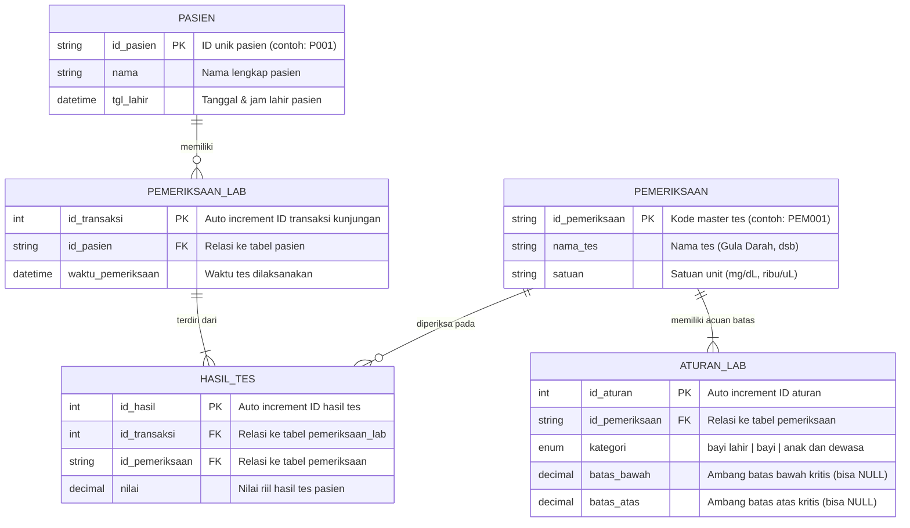

# Sistem Evaluasi Nilai Kritis Laboratorium (Magang RS)

Proyek ini merupakan sistem evaluasi hasil tes laboratorium rumah sakit untuk mendeteksi kondisi **kritis** atau **aman** pada pasien berdasarkan kategori usia (bayi baru lahir, bayi, serta anak dan dewasa).

---

## 1. Entity Relationship Diagram (ERD)

Berikut adalah diagram relasi entitas (ERD) dari struktur database MySQL yang dinormalisasi:



---

## 2. Kamus Data (Data Dictionary)

### A. Tabel `pasien`
Menyimpan profil identitas pasien beserta waktu kelahirannya.
| Nama Kolom | Tipe Data | Constraint | Keterangan |
| :--- | :--- | :--- | :--- |
| `id_pasien` | `VARCHAR(10)` | **PRIMARY KEY** | Kode unik pasien (contoh: `P001`, `P002`) |
| `nama` | `VARCHAR(100)` | NOT NULL | Nama pasien |
| `tgl_lahir` | `DATETIME` | NOT NULL | Waktu lahir pasien untuk menghitung umur presisi |

### B. Tabel `pemeriksaan`
Master katalog jenis tes/pemeriksaan laboratorium.
| Nama Kolom | Tipe Data | Constraint | Keterangan |
| :--- | :--- | :--- | :--- |
| `id_pemeriksaan` | `VARCHAR(10)` | **PRIMARY KEY** | Kode unik pemeriksaan (contoh: `PEM001`) |
| `nama_tes` | `VARCHAR(100)` | NOT NULL | Nama tes lab (Gula Darah, Bilirubin Total, Trombosit) |
| `satuan` | `VARCHAR(20)` | NOT NULL | Satuan pengukuran (mg/dL, ribu/uL, dll.) |

### C. Tabel `aturan_lab`
Menyimpan ambang batas kritis laboratorium berdasarkan pengelompokan usia.
| Nama Kolom | Tipe Data | Constraint | Keterangan |
| :--- | :--- | :--- | :--- |
| `id_aturan` | `INT` | **PRIMARY KEY**, AUTO_INCREMENT | ID unik aturan |
| `id_pemeriksaan` | `VARCHAR(10)` | **FOREIGN KEY** | Mengacu ke `pemeriksaan.id_pemeriksaan` |
| `kategori` | `ENUM` | NOT NULL | `'bayi lahir'`, `'bayi'`, `'anak dan dewasa'` |
| `batas_bawah` | `DECIMAL(10,2)` | NULL | Batas bawah (bila nilai < batas ini, status KRITIS). Nilai `NULL` jika tidak ada batas bawah. |
| `batas_atas` | `DECIMAL(10,2)` | NULL | Batas atas (bila nilai > batas ini, status KRITIS). Nilai `NULL` jika tidak ada batas atas. |

### D. Tabel `pemeriksaan_lab` (Header Transaksi)
Menyimpan catatan kunjungan / sesi pemeriksaan laboratorium seorang pasien pada waktu tertentu.
| Nama Kolom | Tipe Data | Constraint | Keterangan |
| :--- | :--- | :--- | :--- |
| `id_transaksi` | `INT` | **PRIMARY KEY**, AUTO_INCREMENT | ID unik transaksi pemeriksaan |
| `id_pasien` | `VARCHAR(10)` | **FOREIGN KEY** | Mengacu ke `pasien.id_pasien` |
| `waktu_pemeriksaan` | `DATETIME` | NOT NULL | Waktu pengambilan sampel / pemeriksaan lab |

### E. Tabel `hasil_tes` (Detail Transaksi)
Menyimpan nilai riil hasil tes yang dilakukan dalam suatu transaksi pemeriksaan.
| Nama Kolom | Tipe Data | Constraint | Keterangan |
| :--- | :--- | :--- | :--- |
| `id_hasil` | `INT` | **PRIMARY KEY**, AUTO_INCREMENT | ID unik record hasil tes |
| `id_transaksi` | `INT` | **FOREIGN KEY** | Mengacu ke `pemeriksaan_lab.id_transaksi` |
| `id_pemeriksaan` | `VARCHAR(10)` | **FOREIGN KEY** | Mengacu ke `pemeriksaan.id_pemeriksaan` |
| `nilai` | `DECIMAL(10,2)` | NOT NULL | Nilai hasil uji lab pasien |

---

## 3. Relasi Antar Tabel (Relationship & Cardinality)

1. **`pasien` ke `pemeriksaan_lab` (One-to-Many / 1:N)**:
   - Satu pasien dapat memiliki satu atau lebih riwayat transaksi pemeriksaan lab di waktu yang berbeda.
2. **`pemeriksaan_lab` ke `hasil_tes` (One-to-Many / 1:N)**:
   - Satu transaksi pemeriksaan lab dapat terdiri dari banyak item hasil tes lab sekaligus.
3. **`pemeriksaan` ke `hasil_tes` (One-to-Many / 1:N)**:
   - Satu jenis master pemeriksaan dapat muncul di banyak catatan hasil tes pasien.
4. **`pemeriksaan` ke `aturan_lab` (One-to-Many / 1:N)**:
   - Satu jenis master pemeriksaan memiliki beberapa acuan batas normal/kritis yang berbeda tergantung kategori usia.

---

## 4. Logika Bisnis Nilai Kritis

1. **Penentuan Kategori Usia**:
   - Selisih waktu dari `pasien.tgl_lahir` ke `pemeriksaan_lab.waktu_pemeriksaan`:
     - `< 72 jam` : **`bayi lahir`**
     - `>= 72 jam` s/d `< 1 tahun` : **`bayi`**
     - `>= 1 tahun` : **`anak dan dewasa`**
2. **Evaluasi Nilai Kritis**:
   - **KRITIS (TRUE)** jika:
     - `batas_bawah IS NOT NULL` dan `nilai < batas_bawah`
     - ATAU `batas_atas IS NOT NULL` dan `nilai > batas_atas`
   - **TIDAK KRITIS (FALSE)** jika nilai berada dalam rentang aman.

---

## 5. Panduan Instalasi & Penggunaan

### Import Skema ke MySQL
Gunakan file [`database.sql`](file:///home/lobster/Local/MagangRS/database.sql):
```bash
mysql -u root -p < database.sql
```
Atau melalui phpMyAdmin / GUI client (DBeaver, HeidiSQL, Navicat):
1. Buka menu **Import**.
2. Pilih file `database.sql`.
3. Klik **Go** / **Execute**.

### Menjalankan Simulator Web (Form & Tabel Interaktif)
Jalankan built-in server PHP di folder proyek:
```bash
php -S localhost:8000
```
Buka browser favorit Anda di alamat:
- **`http://localhost:8000/`** atau **`http://localhost:8000/hasil_lab.php`**

**Fitur Antarmuka Web**:
- **Form Input Pasien**: Mengisi nama, tanggal/jam lahir, waktu tes, dan nilai tes lab.
- **Tombol Muat Cepat (*Presets*)**: Mengisi instan data contoh pasien bayi baru lahir, bayi, dan dewasa.
- **Live Kategori Usia**: Preview pengelompokan usia secara *real-time* saat tanggal diubah.
- **Hasil Evaluasi**: Tampilan kartu ringkasan, banner status peringatan medis, dan tabel hasil lengkap dengan indikator badge warna (**KRITIS** / **AMAN**).
- **Tabel Riwayat Pasien & Matriks Acuan**: Menampilkan data pasien yang tersimpan serta tabel batas kritis lab.

### Menjalankan Melalui Terminal (CLI)
Jika ingin melihat hasil simulasi langsung di terminal:
```bash
php hasil_lab.php
```
